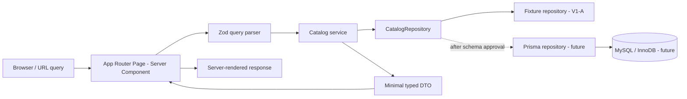

# Kiến trúc đích cho V1-A

## Nguyên tắc

- Next.js 16 App Router, React 19 và TypeScript strict; Server Components là mặc định.
- Public pages đọc catalog qua server-only DAL, không gọi Route Handler của chính ứng dụng.
- URL là nguồn sự thật cho tìm kiếm, lọc, sắp xếp và phân trang.
- Giữ fixture repository trong V1-A; interface hiện có cho phép thay nguồn đọc mà không đưa business logic vào page.
- MySQL + Prisma là đích đã chốt, nhưng chỉ chuyển sau khi duyệt schema, MySQL version/collation và migration plan.
- Tài liệu tham chiếu chưa xác minh được backend hoặc hành vi nội bộ; không tái sử dụng private API, protected content hay asset chưa được cấp phép.

## Cấu trúc hiện tại và hướng mở rộng

```text
src/
  app/
    layout.tsx
    page.tsx
    search/page.tsx
    search/loading.tsx
    category/[slug]/page.tsx
    story/[slug]/page.tsx
    error.tsx
    not-found.tsx
  components/
    catalog/                 # cards, filter, pagination, states
    site/                    # header, navigation, footer, search form
  features/
    catalog/                 # model, query schema, normalization, service, repository
  lib/                       # shared presentation helpers
  styles/                    # chỉ tách token khi có nhu cầu dùng chung
tests/
  catalog.test.ts
```

Chỉ thêm `features/reader`, `features/auth`, `features/admin`, `lib/db` và `prisma/` trong milestone tương ứng. Không tạo provider toàn cục hoặc client store chỉ để chuẩn bị cho tính năng tương lai.

## Route và ranh giới render

| Route | Data/behavior | Render |
| --- | --- | --- |
| `/` | Trang chủ lấy các section từ catalog service. | Server Component. |
| `/category/[slug]` | Resolve category, parse `status/sort/page`, hiển thị danh sách. | Server Component; query params được xác thực tại page boundary. |
| `/story/[slug]` | Resolve truyện đã public, metadata và chi tiết. | Server Component. |
| `/search` | Parse `q/category/status/sort/page`, tìm/lọc/phân trang. | Server Component. |

Header, StoryCard, StoryGrid, Filter, Pagination, EmptyState và StoryDetail hiện không cần state browser. Search/filter submit qua GET forms và navigation bằng Link; không cần `use client`. `error.tsx` là Client Component theo yêu cầu của Next error boundary.

## Data flow



`catalog.server.ts`/repository là server-only composition boundary. Service sở hữu publication filtering, query matching, stable ordering, pagination metadata và DTO mapping. Page chỉ điều phối parse, service calls, metadata và trạng thái render. Fixture internals như `authorId`, `categoryIds` không đi xuống component.

## Query contract

`/search?q=&category=&status=&sort=&page=` và `/category/[slug]?status=&sort=&page=` là contract của ứng dụng này, không phải hành vi đã xác minh của website tham chiếu.

- `q`: chuỗi đã trim và gộp whitespace; tối đa 100 ký tự; search theo title và author.
- `category`: một category slug; chỉ có ở `/search`.
- `status`: `ongoing | completed | hiatus`.
- `sort`: `updated | newest | title`; mặc định `updated`.
- `page`: chuỗi số nguyên 1–100; mặc định 1; kích thước trang 24.
- Duplicate, unsupported và sai kiểu/giá trị trả validation result có kiểu; UI trình bày lỗi rõ ràng.
- Sorting có tie-breaker id; trang vượt tổng trang trả empty/out-of-range state.

Không chuẩn hóa title/author lưu trữ để hiển thị. Chuẩn hóa chỉ áp dụng cho bản so sánh tìm kiếm. Query sort/page đơn thuần không được coi là ý định tìm kiếm nếu không có từ khóa hoặc filter.

## Ranh giới client

Client Component chỉ dùng khi UI cần state, browser API hoặc event handler (ví dụ menu/dialog được thêm sau này). Đặt `'use client'` tại leaf nhỏ nhất; chỉ truyền DTO cần render. Không serialize fixture đầy đủ, không chuyển root layout/page thành client vì một control đơn lẻ.

## SEO, cache và nội dung

- Root metadata hiện đặt `robots: noindex, nofollow`; giữ trạng thái preview cho tới khi domain/canonical và quyền public được duyệt. M4 production build/HTTP smoke xác nhận header metadata này hiện diện trên các route.
- `metadataBase`, canonical domain và sitemap không được tự suy đoán.
- Story/category metadata chỉ được tạo từ public DTO. Khi dùng database, public predicate phải yêu cầu `publicationStatus = PUBLISHED` và rights gate hợp lệ.
- Cache tag/revalidation chỉ thiết kế khi có nguồn database/mutation. Không cache draft, chapter body chưa duyệt, dữ liệu tài khoản hay thông tin cá nhân vào public cache.
- Không ghi chapter body, comment body, email, token/cookie/session ID hay secret vào log.

## Trình tự chuyển nguồn dữ liệu

1. Duyệt các quyết định database trong `docs/database/`.
2. Chọn phiên bản MySQL, charset/collation, Prisma major/driver/generator và migration owner.
3. Duyệt logical schema, rights predicate và slug strategy.
4. Tạo Prisma schema/migration ở milestone database riêng; bổ sung repository integration tests và kiểm tra query plan.
5. Chỉ chuyển public repository sau khi test chứng minh draft/rights-invalid content không xuất hiện.

## Căn cứ kỹ thuật

- [Server and Client Components](https://nextjs.org/docs/app/getting-started/server-and-client-components)
- [Fetching data](https://nextjs.org/docs/app/getting-started/fetching-data)
- [Page props and searchParams](https://nextjs.org/docs/app/api-reference/file-conventions/page)
- [Metadata API](https://nextjs.org/docs/app/api-reference/functions/generate-metadata)
