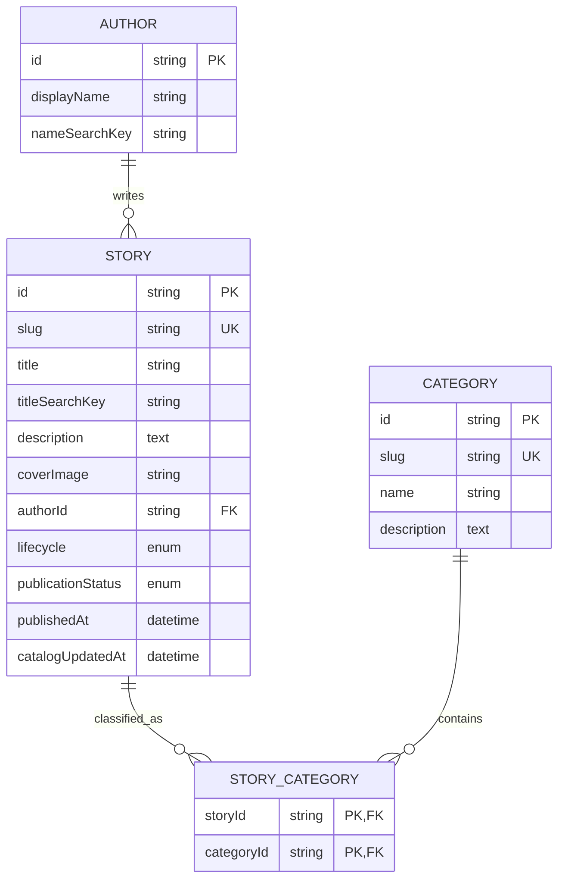

# Thiết kế logical schema — MySQL + Prisma

**Trạng thái:** đề xuất để duyệt; chưa có `schema.prisma`, package Prisma, migration hay kết nối MySQL. Database dài hạn vẫn là MySQL/InnoDB + Prisma theo quyết định đã chốt.

## Nguyên tắc thiết kế

- V1-A cần catalog metadata và truy vấn danh sách; không cần chapter, account hay user-generated content.
- Một story hiện có một tác giả và nhiều thể loại. Đây là hình dạng của model/fixture/UI hiện tại; đồng tác giả cần xác nhận trước migration.
- Story và category dùng id nội bộ ổn định; slug chỉ là định danh route công khai.
- Publication status và lifecycle là hai khái niệm riêng.
- Public reads chỉ trả story đã publish; khi rights workflow được thêm, phải đồng thời yêu cầu rights được xác minh.
- Tách search key dẫn xuất khỏi title/name để giữ quy tắc chuẩn hóa tiếng Việt nhất quán, nếu query DB cần tương đương với fixture search.

## ERD V1 catalog

`nameSearchKey`/`titleSearchKey` là trường dẫn xuất tùy thuộc quyết định search bên dưới; chúng không phải giá trị hiển thị. Nếu normalization không được duyệt cho DB, không tạo chúng theo mặc định.

## Phân loại model

| Model | Thời điểm | Trường/quan hệ cốt lõi |
| --- | --- | --- |
| `Author` | Cần cho catalog DB | `id`, `displayName`; search key chỉ khi chốt query semantics. Không cần slug nếu chưa có route tác giả. |
| `Story` | Cần cho catalog DB | `id`, unique `slug`, `title`, `description`, `coverImage`, `authorId`, `lifecycle`, `publicationStatus`, `publishedAt`, `catalogUpdatedAt`; có thể thêm `titleSearchKey`. |
| `Category` | Cần cho catalog DB | `id`, unique `slug`, `name`, optional `description`. |
| `StoryCategory` | Cần cho catalog DB | Join table explicit, khóa kép story/category. |
| `StorySlug` registry | Chỉ cần trước khi bật slug aliases | Một namespace duy nhất cho canonical và alias nếu cần enforce uniqueness cross-table; có thể thay mô hình canonical slug hiện tại sau khi duyệt. Chưa cần V1-A. |
| `StoryRights` | Cần trước khi public catalog có nội dung thật | Rights status/basis, provenance/reference, verifier và timestamp; không lưu tài liệu pháp lý nhạy cảm ở public row. |
| `Chapter`, `ChapterRights` | Giai đoạn reader | Chapter metadata/body và quyền theo chapter; cách kế thừa quyền story cần quyết định. |
| `User`, `Account`, `Session` | Giai đoạn auth | Chỉ sau khi duyệt identity provider, retention và session strategy. |
| `Bookmark`, `ReadingHistory` | Giai đoạn account | User-story unique; history hiện chưa rõ là vị trí mới nhất hay event log. |
| `Comment`, moderation, ratings/reactions | Giai đoạn UGC | Chỉ sau khi chốt moderation, retention và ý nghĩa của vote/rating/support. |

## Enums và trạng thái

- `Story.lifecycle`: `ONGOING | COMPLETED | HIATUS`, mô tả trạng thái tác phẩm.
- `Story.publicationStatus`: repository hiện dùng `DRAFT | PUBLISHED | ARCHIVED`.
- Research 10 còn đề xuất `HIDDEN | REMOVED`; đây là lựa chọn rộng hơn chưa có trong fixture/API hiện tại. Không đưa vào enum DB trước khi chốt semantics, redirect/retention và khả năng khôi phục.
- `RightsStatus` không phải publication status. Khi rights được triển khai, chỉ trạng thái được xác minh mới thỏa public gate.
- Kiểm tra tính nhất quán `publishedAt`/`publicationStatus` bằng domain validation và, sau khi xác nhận tương thích MySQL mục tiêu, có thể thêm CHECK constraint. Không phụ thuộc vào behavior CHECK chưa được kiểm chứng.

## Search tiếng Việt cho DB

Fixture search hiện chuẩn hóa hoa/thường, dấu thanh, `đ/d` và khoảng trắng; DB phải giữ được cùng hợp đồng nếu chuyển nguồn dữ liệu. Không suy ra rằng collation MySQL bất kỳ sẽ ánh xạ `đ` về `d`.

Đề xuất cho lần triển khai catalog DB:

1. Chốt hàm normalize dùng chung và test với từ khóa tiếng Việt đã duyệt.
2. Nếu cần chứa substring như fixture, lưu `titleSearchKey` và `Author.nameSearchKey` được sinh cùng transaction với source fields.
3. `LIKE '%term%'` trên search key bảo toàn semantics nhưng không được coi là được B-tree index tăng tốc. Đo query time/EXPLAIN trên tập synthetic đủ lớn.
4. Chỉ thêm FULLTEXT sau benchmark tokenizer/relevance tiếng Việt; nếu cần typo tolerance/facet/ranking vượt DB thì đánh giá Meilisearch riêng.

## Quyết định cần duyệt trước khi tạo schema

- MySQL version/hosting, charset/collation và timezone convention.
- Prisma major, driver adapter/generator và biến môi trường triển khai.
- Single-author hiện tại hay M:N `StoryAuthor`; nếu M:N cần author role/order/primary author?
- Chuẩn hóa search key trong DB hay đổi search contract; collation không tự quyết định `d/đ`.
- Publication enum giữ 3 trạng thái hiện có hay cần `HIDDEN/REMOVED`.
- Rights verification bắt buộc ở Story, Chapter hay cả hai; chapter có kế thừa quyền hay không.
- ID format và ownership của migration/production deploy.
